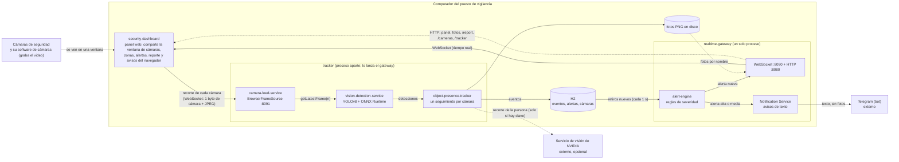

# Arquitectura general (estado actual)

Lo que corre hoy en el computador del puesto de vigilancia. La vista To-Be (nube, login con Google, correo) está en el modelo
ArchiMate `safemode-arquitectura.archimate`.

- Línea sólida: comunicación implementada. Dentro del computador, el tracker corre en un proceso aparte que el gateway lanza (botón
  **Iniciar vigilancia**) y detiene con la señal «stop»; el tracker y el gateway comparten la base H2.
- Línea punteada: el navegador pide la página, las fotos, el reporte y los nombres de las cámaras por HTTP; las fotos las escribe el
  tracker en disco y el gateway las entrega solo por nombre de archivo.
- **Dos cámaras:** el panel manda el recorte de cada cámara con su número (1 a 8) y el tracker crea un detector y un seguimiento por
  cámara (1 cámara usa `yolov8m`; 2 cámaras usan `yolov8s`).
- **Avisos:** el aviso del navegador lo muestra el propio panel con cada alerta nueva; el Notification Service manda el texto a Telegram
  (lista fija de chats, solo alertas altas y medias, en hilos aparte para no frenar la alerta). Correo y login con Google son pendientes.
- `alert-engine` y `security-dashboard` no tienen contenedor propio: el motor y el servicio de notificaciones corren dentro del
  proceso del gateway y el panel es una página que el gateway entrega.
- **Con Docker** (ADR 0002): `docker compose up --build h2-db realtime-gateway` levanta la base en modo servidor y el gateway; el
  tracker sigue en el computador con `SAFEMODE_DB_URL=jdbc:h2:tcp://localhost:9093/presence`. En Docker el botón de vigilancia no se
  ofrece (el gateway escucha fuera de `localhost`).
- Sin Docker también funciona: si no se define `SAFEMODE_DB_URL`, el tracker y el gateway comparten el archivo H2 local
  (`AUTO_SERVER`).

Ver [ADR 0001](../adr/0001-contenerizacion-servicios-captura-pantalla.md) para como se contenerizan los servicios de
captura, [ADR 0002](../adr/0002-docker-compose-gateway-y-base-de-datos.md) para la base de datos compartida y el
gateway, [ADR 0003](../adr/0003-dos-camaras-zonas-y-reporte.md) para las dos cámaras y el reporte y
[ADR 0004](../adr/0004-login-google-y-notificaciones.md) para los avisos y el login.
