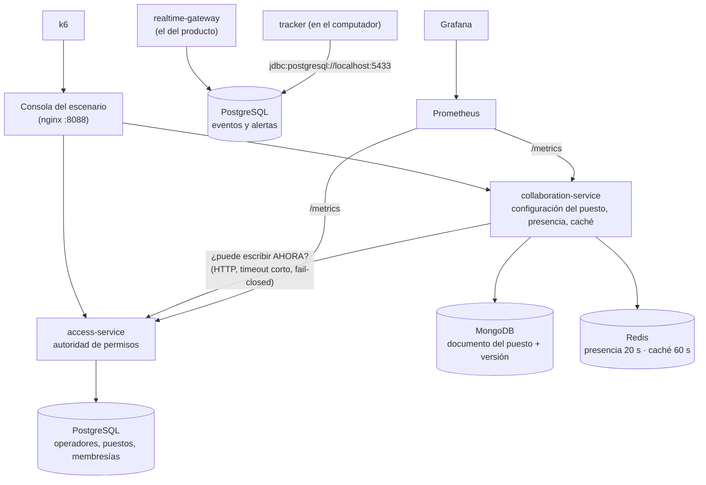

# Persistencia, consistencia y observabilidad en Safemode

Laboratorio ARSW de persistencia aplicado al proyecto: **PostgreSQL, MongoDB y Redis** sobre Docker Compose, con **Prometheus,
Grafana y k6** para comprobar el comportamiento. Rama: `heverpersistencia`.

| Entregable | Dónde está |
|---|---|
| Matriz de decisiones | [`MATRIZ.md`](MATRIZ.md) |
| ADR | [`docs/adr/0005-persistencia-consistencia-observabilidad.md`](../adr/0005-persistencia-consistencia-observabilidad.md) |
| Evidencias antes/después | [`EVIDENCIAS.md`](EVIDENCIAS.md) y la carpeta [`evidencias/`](evidencias/) |
| Dashboard exportado (8 paneles) | [`dashboard.json`](dashboard.json) |
| Código | `service-common/`, `access-service/`, `collaboration-service/`, `docker-compose.persistencia.yml`, `persistencia/` y los cambios de SQL en `object-presence-tracker/` y `alert-engine/` |

## 1. Qué se agregó (y qué no se tocó)



- **Nuevo:** `service-common` (mini servidor HTTP y métricas), `access-service` (Gestión · PostgreSQL), `collaboration-service`
  (MongoDB + Redis) y la consola de dos identidades. Son piezas aparte: el panel y el gateway no dependen de ellas.
- **Cambiado, sin cambiar el comportamiento por defecto:** `PresenceEventStore` y `AlertStore` aceptan PostgreSQL además de H2
  (`SqlDialect` reúne las 3 instrucciones que difieren). **Sin `SAFEMODE_DB_URL` todo sigue en H2, como antes**; los 307 tests
  Java que ya existían siguen pasando (`mvn test`: 340 en total, 0 fallos; los 33 nuevos incluyen 3 contra PostgreSQL real que se omiten
  si no se define `SAFEMODE_TEST_PG_URL`).
- **No se tocó:** el panel (`security-dashboard/`), los otros servicios ni sus Dockerfiles. Los módulos nuevos entran al reactor de
  Maven con un perfil que se activa solo si sus carpetas existen (así las imágenes que ya funcionaban no se rompen).

## 2. Requisitos y arranque

Docker Desktop (o Docker Engine) **en ejecución** y Docker Compose v2 con `--wait`. No hace falta Java, Python ni las bases instaladas.
Se asignan ≈ 6 GB de RAM a Docker como punto de partida. La primera vez descarga imágenes y compila (varios minutos).

Antes del primer arranque: `Copy-Item .env.example .env` y complete `SAFEMODE_GOOGLE_CLIENT_ID` y `SAFEMODE_ALLOWED_EMAILS` (el gateway no
arranca sin ellos). El proyecto de Docker se llama **`safemode-arsw`** (fijo en `docker-compose.yml`): sus contenedores, red y volúmenes no se
mezclan con los del laboratorio (`arsw-persistencia`). Los dos usan los mismos puertos (8080, 9090, 3000): no los levante a la vez.

```powershell
# PowerShell, desde la raíz del repo
docker compose -f docker-compose.yml -f docker-compose.persistencia.yml up -d --build --wait --wait-timeout 300 `
  postgres mongo redis access-service collaboration-service console prometheus grafana realtime-gateway
docker compose -f docker-compose.yml -f docker-compose.persistencia.yml ps
docker compose -f docker-compose.yml -f docker-compose.persistencia.yml run --rm tools smoke
```

(En bash, cambie la continuación `` ` `` por `\`.) Para no repetir los `-f`, en la sesión: `$env:COMPOSE_FILE = "docker-compose.yml;docker-compose.persistencia.yml"`
(en bash: `export COMPOSE_FILE=docker-compose.yml:docker-compose.persistencia.yml`).

| Acceso | URL / credenciales |
|---|---|
| Consola del escenario | http://localhost:8088 |
| API de colaboración | `http://localhost:8088/api/puestos/puesto-1` |
| API de Gestión | `http://localhost:8088/access/permissions/puesto-1/luis` |
| Panel de alertas del producto (sobre PostgreSQL) | http://localhost:8080 |
| Grafana | http://localhost:3000 · `admin` / `lab-grafana` · carpeta **ARSW** |
| Prometheus | http://localhost:9090 · estado de los targets en `/targets` |
| Clave de administración del escenario | `lab-admin` (cabecera `X-Lab-Key`) |

Los puertos web van solo en `127.0.0.1`. MongoDB y Redis no publican puertos; PostgreSQL sí (`127.0.0.1:5433`) porque el tracker corre
en el computador. Las identidades `ana`, `luis` y `marta` se simulan con la cabecera `X-Operator`: **no hay autenticación de producción**.
No exponga este entorno a Internet. Para cambiar puertos o claves (y poner el inicio de sesión con Google): `Copy-Item .env.example .env` y editar `.env`.

Grafana trae la fuente **Prometheus** y dos dashboards en la carpeta **ARSW**: *SAFEMODE · Punto de partida* (2 paneles) y
*ARSW-EQP-01 · Persistencia (Safemode)* (los 8 del laboratorio). Además carga, en la carpeta **SafeMode**, el tablero de Kevyn tal cual cuando él
lo exporte a `observability/grafana/dashboards/` (hoy solo vive en su Grafana; ver el README de esa carpeta). Espere 15–30 s al primer *scraping*.

**Una sola observabilidad.** Este Prometheus lee cuatro objetivos (`persistencia/monitoring/prometheus.yml`): `access`, `collaboration`, el
`gateway` del producto (métricas de la rama de Kevyn, puerto 9464 del contenedor) y la sonda `ready-probe` (blackbox → `/ready` del gateway).
Todo con el prefijo `safemode_` y la misma librería (Micrometer 1.13.6), y `safemode_dependency_up` incluye ahora `gateway → database`.
`docker-compose.observability.yml` (el de Kevyn) sigue sirviendo para correr el gateway **en el computador, sin Docker**; **no se usa junto con
este compose**: los dos publican Prometheus en el 9090 y Grafana en el 3000.

## 3. Las tres decisiones (dónde están en el código)

Todo lo que se defiende está en **un solo archivo por modo**: `collaboration-service/src/main/java/com/safemode/collab/decisions/`.

| # | Decisión | Solución (`SafeDecisions`) | Defecto del punto de partida (`BaselineDecisions`) |
|---|---|---|---|
| 1 | Evitar la edición perdida | `findOneAndUpdate({_id, version})` con `$inc`: comparar y subir la versión en **una** operación → 200 y 409 | `find` y luego `update` sin condición → 200 y 200 |
| 2 | Revocación frente a caché | Una escritura **siempre** pregunta a la autoridad: 403 si fue revocado, 503 si no responde | Cree la caché (hasta 60 s) → sigue escribiendo quien ya no tiene permiso |
| 3 | Presencia efímera, Redis opcional | `SET … EX 20` en **una** escritura; sin Redis → 200 `available:false` y sube `safemode_degraded_total` | `SET` sin vencimiento y sin atrapar la falla → no expira; con Redis caído, 503 |

`DECISIONS_MODE=base` activa los defectos a propósito (el servicio lo anuncia al arrancar) para **repetir la medición del «antes»**.
El valor por defecto es `solucion`.

## 4. Pruebas y experimentos

Todos los comandos llevan `docker compose -f docker-compose.yml -f docker-compose.persistencia.yml`, abreviado `dc` aquí. En PowerShell:
`function dc { docker compose -f docker-compose.yml -f docker-compose.persistencia.yml @args }`; en bash:
`dc() { docker compose -f docker-compose.yml -f docker-compose.persistencia.yml "$@"; }` (en Git Bash anteponga `MSYS_NO_PATHCONV=1` para rutas como `/lab/evidence.sql`). Los JSON
quedan en `persistencia/results/` (excluido de Git: copie a mano los que entregue a `docs/persistencia/evidencias/`).

### 4.1 Elegir antes de corregir: las garantías de PostgreSQL

```powershell
dc exec -T postgres psql -U safemode -d safemode -f /lab/evidence.sql
```

Verá **seis `ERROR` previstos** (clave primaria, dos claves foráneas, `CHECK`, `UNIQUE` del correo y `UNIQUE` de la alerta por evento),
cada uno dentro de una transacción revertida, y una revocación revertida con `ROLLBACK`. No elimine restricciones para que desaparezcan.

### 4.2 Medir el «antes» (defectos) y el «después» (solución)

```powershell
# ANTES: servicio con los defectos del punto de partida
$env:DECISIONS_MODE = "base"
dc up -d --force-recreate --wait collaboration-service
dc run --rm tools baseline            # ≈ 22 s; es normal ver passed:false en conflicto, revocación y expiración (sale con código 0)

# DESPUÉS: la solución
$env:DECISIONS_MODE = "solucion"
dc up -d --force-recreate --wait collaboration-service
dc run --rm tools acceptance          # debe terminar con todos los passed:true y código 0
```

`--force-recreate` es necesario para que el servicio lea el nuevo `DECISIONS_MODE`. Reiniciar el servicio reinicia sus contadores en
memoria; Prometheus conserva las muestras (`rate` maneja los reinicios), pero compare ventanas claramente identificadas.

### 4.3 Fallos controlados

No ejecute `reset`, k6 ni otras ediciones mientras corre `acceptance`, y no haga clic repetido en «Registrar presencia» durante la
prueba de expiración.

**Experimento 1 · dos pestañas.** Abra http://localhost:8088 dos veces. Cargue la misma versión en ambas; en la segunda elija **Luis**.
Guarde en la primera y luego en la segunda: con la solución verá **200 y 409**. Un 409 no es una caída: es el servidor rechazando
correctamente una edición sobre una versión vieja.

**Experimento 2 · Redis detenido.**

```powershell
dc run --rm tools reset
dc stop redis
dc run --rm tools redis-down
dc start redis          # ejecútelo SIEMPRE, aunque la prueba falle
dc exec redis redis-cli ping
dc run --rm tools redis-up   # la PRIMERA presencia tras restaurar debe quedar registrada (el pool no usa conexiones muertas)
```

En Grafana, `safemode_dependency_up` baja a 0 para Redis mientras los dos servicios siguen con `up=1`. Con la solución, la edición
responde 200 y la presencia 200 degradada (`available:false`).

**Experimento 3 · autoridad de permisos no disponible.** Con Redis y Gestión funcionando, pulse **Consultar permiso en caché** como Ana
(para cachearlo). Luego:

```powershell
dc stop access-service
dc run --rm tools authority-down
dc start access-service      # obligatorio
```

Se espera **503** aunque exista un permiso cacheado. Si el *proxy* devuelve 502 tras recrear contenedores: `dc restart console`.

### 4.4 Prometheus, Grafana y k6

```powershell
dc run --rm k6                # 100 s, 5 usuarios virtuales en la meseta; solo LECTURAS
Rename-Item persistencia\results\k6-carga-summary.json k6-carga-solucion.json   # se sobrescribe en la siguiente carga
```

Extensiones opcionales: `dc run --rm -e TYPE=estres k6` (10→30→60 VU), `pico`, `resistencia` (5 min). Los umbrales (P95 < 500 ms, errores
< 1 %) son hipótesis de clase. El resumen de k6 **no se importa en Grafana**: Grafana muestra las métricas HTTP que los servicios exponen y
Prometheus recopila durante la carga. El P95 de k6 mide el recorrido del cliente; el del backend mide su procesamiento y se estima con
cubetas: no tienen por qué coincidir.

Los seis paneles añadidos y sus consultas están en el dashboard `persistencia.json` (y exportados en `dashboard.json`).

### 4.5 El producto sobre PostgreSQL (extremo a extremo)

El gateway del compose ya usa PostgreSQL. Para comprobar el flujo real (evento → alerta) sin cámara, inserte un retiro sospechoso en la
base y vea que el motor de alertas crea la alerta:

```powershell
dc exec -T postgres psql -U safemode -d safemode -c "INSERT INTO object_presence_event (tracked_object_id, class_name, event_type, occurred_at, pos_x, pos_y, width, height, person_nearby, removal_kind, camera_id, remover_looks_like_owner) VALUES (1, 'suitcase', 'REMOVED', now(), 10, 10, 50, 80, true, 'BY_OTHER', 1, false);"
Start-Sleep 3
dc exec -T postgres psql -U safemode -d safemode -c "SELECT id, event_id, alert_type, severity, message FROM alert ORDER BY id DESC LIMIT 3;"
```

El **tracker real** (en el computador, necesita la pantalla y los modelos) escribe en esa misma base:

```powershell
$env:SAFEMODE_DB_URL = "jdbc:postgresql://localhost:5433/safemode?user=safemode&password=lab-postgres"
mvn -pl object-presence-tracker exec:java "-Dexec.mainClass=com.safemode.presence.ObjectPresenceTrackerTest"
```

### 4.6 Reinicio de la base de datos (el gateway se recupera solo)

Los almacenes de eventos y alertas ya no guardan una conexión fija: `ReconnectingConnection` la valida antes de cada operación y, si la base
se reinició, abre otra con la misma URL (con una espera de 1 s entre intentos fallidos para no cargar la consulta de 250 ms del motor).

```powershell
dc restart postgres                      # el gateway pierde la conexión; en /metrics: safemode_dependency_up{dependency="database"} baja a 0
Start-Sleep 10
# el gateway vuelve a leer sin reiniciarlo: este retiro sospechoso debe generar alerta
dc exec -T postgres psql -U safemode -d safemode -c "INSERT INTO object_presence_event (tracked_object_id, class_name, event_type, occurred_at, pos_x, pos_y, width, height, person_nearby, removal_kind, camera_id, remover_looks_like_owner) VALUES (1, 'suitcase', 'REMOVED', now(), 10, 10, 50, 80, true, 'BY_OTHER', 1, false);"
Start-Sleep 3
dc exec -T postgres psql -U safemode -d safemode -c "SELECT id, event_id, alert_type, severity FROM alert ORDER BY id DESC LIMIT 2;"
dc logs --tail=10 realtime-gateway       # busque: [BD] Se perdio la conexion ... / [BD] Reconectado a la base de datos
```

Las pruebas automáticas (`ReconnectingConnectionTest`, `DatabaseRestartTest`) apagan y encienden un servidor H2 real; no necesitan Docker.

### 4.7 Pruebas Java

```powershell
mvn test                                         # todo el proyecto (incluye los módulos nuevos); no necesita Docker
# Los almacenes de eventos y alertas contra el PostgreSQL del compose (se omiten si no se define la variable):
$env:SAFEMODE_TEST_PG_URL = "jdbc:postgresql://localhost:5433/safemode?user=safemode&password=lab-postgres"
mvn -pl alert-engine -am test "-Dtest=PostgresStoresIntegrationTest" "-Dsurefire.failIfNoSpecifiedTests=false"
```

## 5. Operación y solución de problemas

```powershell
dc ps                                            # estado
dc logs --tail=80 collaboration-service access-service
dc run --rm tools reset                          # restablece SOLO los datos ficticios (con las dependencias disponibles)
dc down                                          # detiene conservando datos y dashboards
dc down -v                                       # BORRA los volúmenes de PostgreSQL, MongoDB, Prometheus y Grafana
```

- **Puerto ocupado:** cambie los puertos en `.env` y vuelva a `up -d`.
- **Docker no responde:** abra Docker Desktop y reintente.
- **Sin datos en Grafana:** revise `/targets`, genere peticiones y use «últimos 15 min»; espere al menos dos *scrapes*. Los contadores de
  eventos raros (409, degradación) están en cero desde el arranque.
- **Cambios de código no aplicados:** `dc up -d --build collaboration-service access-service`.
- **503 tras las pruebas:** `dc start redis access-service` y revise `dc logs`.
- **Tras reiniciar PostgreSQL** todo se recupera solo (ver 4.6): Gestión de acceso (pool) y, desde que los almacenes usan
  `ReconnectingConnection`, también el gateway. Antes había que hacer `dc restart realtime-gateway` (`evidencias/15-reinicio-postgres.txt`).
- **Tras detener y restaurar Redis o Gestión** pueden pasar ≈ 2 s antes de que se vuelvan a usar (ventana de fallo rápido); `tools redis-up` lo mide.
- **Las imágenes de `maven` fallan por red:** la primera compilación descarga dependencias de Maven Central.

## 6. Cómo se une con el resto del proyecto

- **Observabilidad (rama `kevynobservabilidad`): ya unida.** El gateway usa Micrometer 1.13.6 (`safemode_alerts_total`,
  `safemode_alert_latency_*`) y estos servicios **la misma librería y versión** con el prefijo `safemode_`, así que el `prometheus.yml`
  de este compose lee los tres (jobs `gateway`, `access` y `collaboration`) más la sonda `/ready`, con los mismos nombres de job que su
  `observability/prometheus.yml` y sin cambiar sus métricas ni su compose (su tablero de Grafana no está en el repo: ver
  `observability/grafana/dashboards/README.md`). El gateway publica además `safemode_dependency_up{dependency="database"}`, con el mismo nombre que los otros.
- **Login con Google (rama `Juli/unión`): ya unido, sin cambiar su lógica.** La lista `SAFEMODE_ALLOWED_EMAILS` sigue decidiendo quién entra. Lo nuevo
  se enciende con `SAFEMODE_COLLAB_URL`, `SAFEMODE_ACCESS_URL` y `SAFEMODE_ACCESS_KEY` (el compose de persistencia ya las pasa): el gateway convierte el correo
  de la sesión en un operador de Gestión de acceso (`POST /operators/provision`) y reemplaza la cabecera `X-Operator` por esa identidad. Todos los
  autorizados **ven** el puesto; **configurar** (zonas compartidas) es solo para los de `SAFEMODE_ADMIN_EMAILS` la primera vez, y después manda PostgreSQL
  (revocar con `PUT /permissions` no se deshace al reiniciar). El panel carga `puesto-sync.js` y comparte las zonas de las cámaras (solo los rectángulos),
  con 409 si dos operadores editan la misma versión, más quién está en línea. Sin esas variables todo funciona como antes.

> **Ojo con el escenario del laboratorio:** `tools reset` y `tools acceptance` restablecen los datos ficticios y **borran a los operadores reales** que dio de
> alta el gateway. No los uso en un despliegue; si se corrieron, los operadores se vuelven a dar de alta en la siguiente petición, pero con los permisos iniciales.
