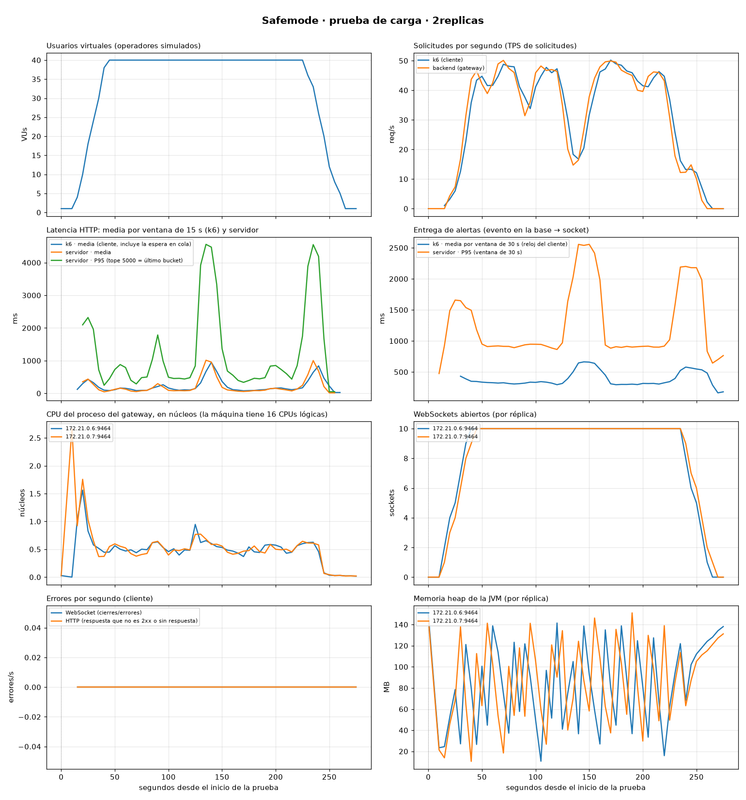
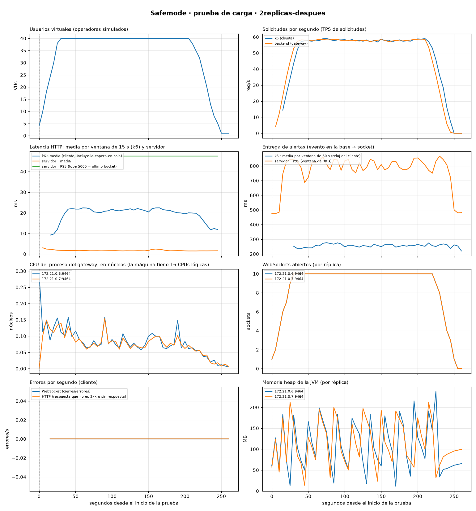
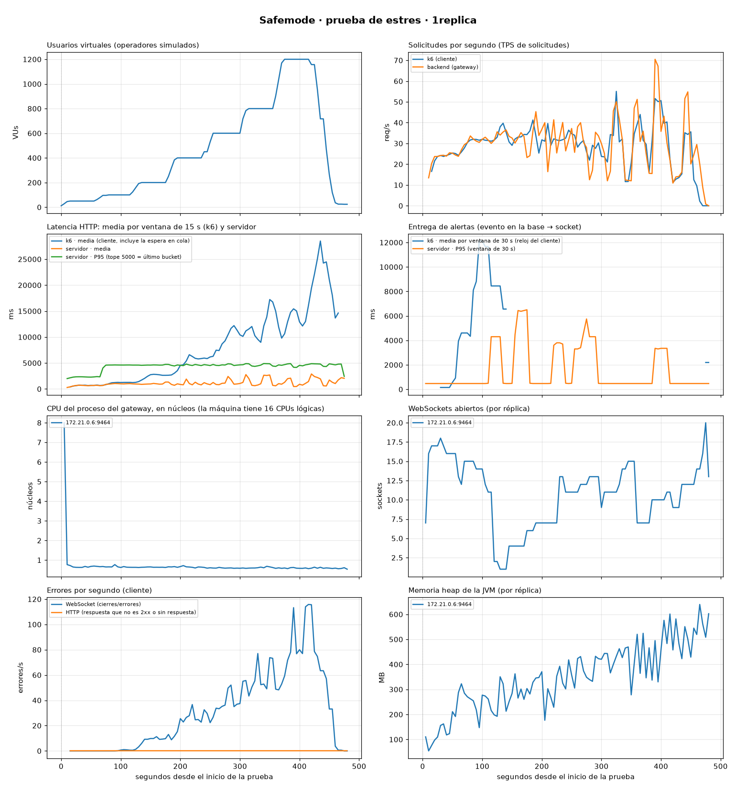
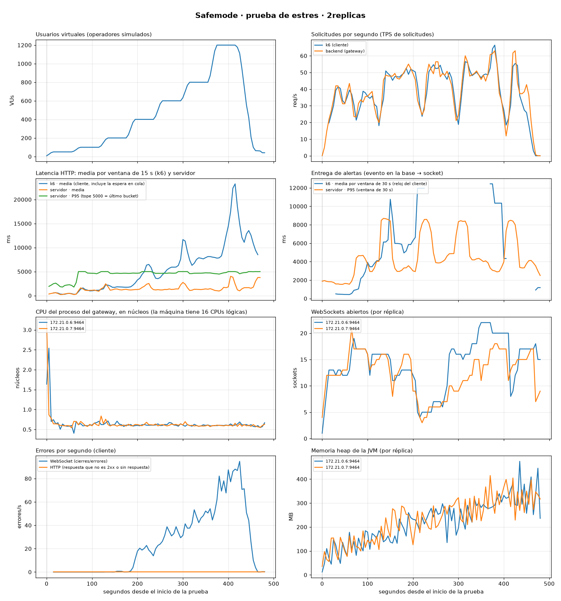
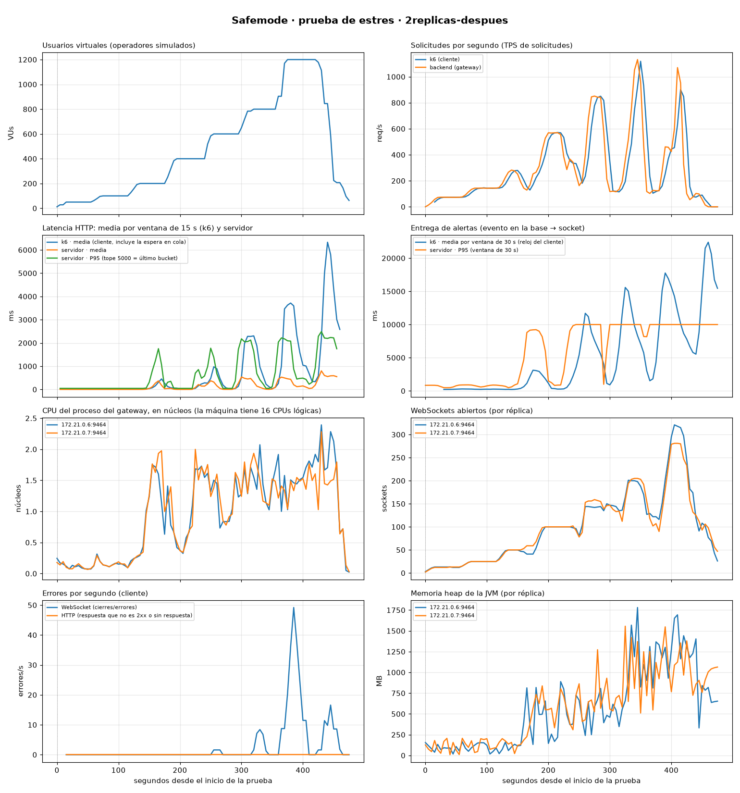
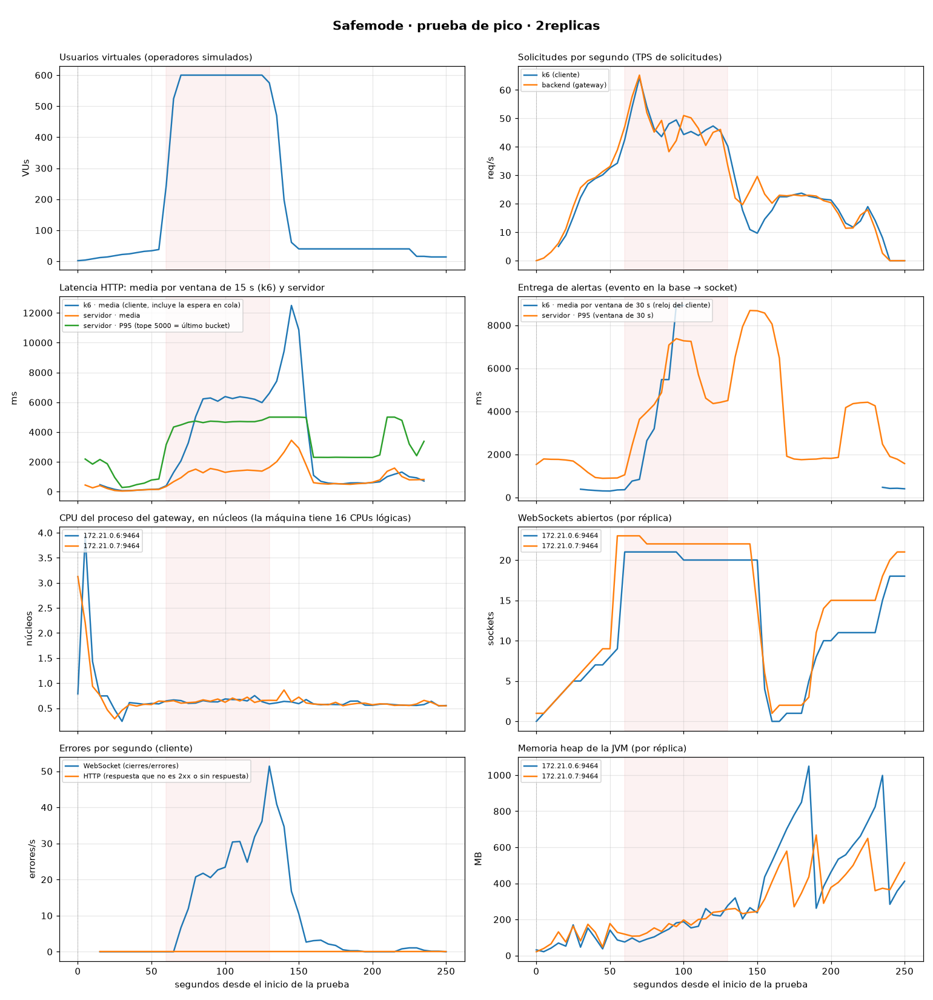
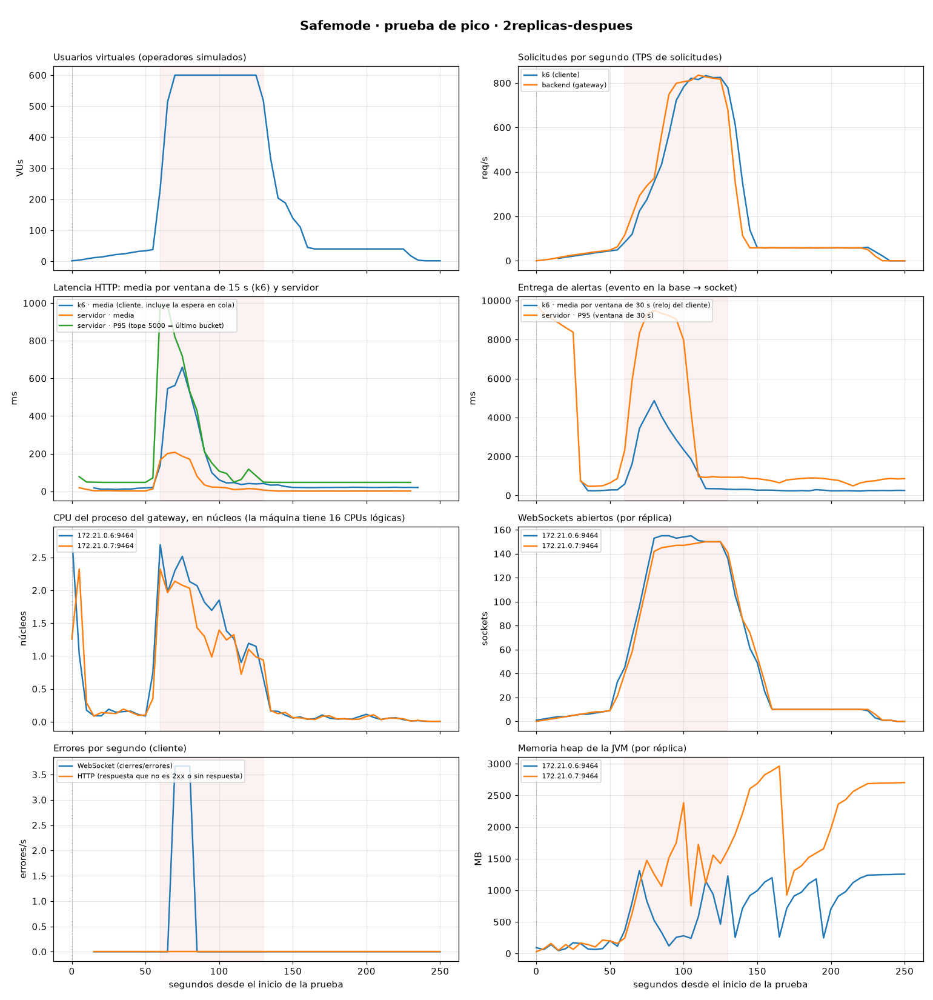

# Rendimiento de Safemode con k6 (Release 2, secciones 2.5 y 2.6)

Qué pide el requerimiento y dónde está cada entregable:

| Entregable | Dónde |
|---|---|
| Flujo objetivo representativo (endpoints, usuarios virtuales, datos, entorno) | [§1](#1-flujo-objetivo-y-entorno) |
| «Transacción» definida, distinta de «solicitud»; fórmulas de TPS y TPM | [§2](#2-qué-es-una-transacción-y-cómo-se-calculan-tps-y-tpm) |
| Tres pruebas (carga, estrés, pico) con umbrales explícitos | [§3](#3-pruebas-y-umbrales-de-aceptación) |
| Resultados reales con gráficas (antes y después de las correcciones) | [§4](#4-resultados) |
| TPS máximo sostenible, TPM y punto de degradación | [§5](#5-tps-máximo-sostenible-tpm-y-punto-de-degradación) |
| Análisis de cuellos de botella | [§6](#6-análisis-de-cuellos-de-botella) |
| Acciones de mejora (aplicadas y recomendadas) | [§7](#7-acciones-de-mejora) |
| Correlación con Prometheus/Grafana y condiciones de degradación detectables (alertas) | [§8](#8-correlación-con-prometheus-y-grafana-y-alertas) |
| Limitaciones, validez de los datos y cómo reproducir | [§9](#9-limitaciones-y-validez-de-los-datos), [§10](#10-cómo-reproducirlo-y-qué-hay-en-cada-carpeta) |

**Estado, sin adornos.**

- Hay **carga, estrés y pico medidos antes y después de las correcciones** (el estrés «antes» con 1 y con 2 réplicas). Las pruebas encontraron un cuello
  de botella real (§6); se corrigió con tres cambios (§7) y la mejora está medida: en el pico, de 25 a 217 solicitudes/s de promedio y de un P95 de 10,3 s a
  0,6 s; en el estrés, de una meseta de 34–48 a 570–678 solicitudes/s (14–18 veces).
- **Lo que sigue incumpliendo** el sistema corregido es la **entrega de alertas** (P95 sobre 5 s) con más de ≈50 operadores en el estrés y con 300 en el pico (§6.2).
  El estrés «después» **empezó con más alertas pendientes que el «antes»** (2.446 contra 1.028, §6.3): es una prueba *más dura*, así que la mejora que muestra es conservadora.
- **Todas las pruebas corrieron en un solo equipo** (el generador de carga comparte CPU con el sistema probado) y **ninguna contra el servidor
  público de AWS** (tiene créditos limitados y no es nuestro para saturarlo). Son cifras relativas: sirven para comparar antes y después y para
  encontrar cuellos de botella; no son la capacidad de la instancia EC2.

---

## 1. Flujo objetivo y entorno

**Uso real que se simula.** Un puesto de vigilancia con *N operadores* que tienen el panel abierto. Cada operador:

1. mantiene **un WebSocket** (`ws://…:8090`) por el que recibe el *snapshot* de alertas pendientes al conectar y cada alerta nueva;
2. mientras trabaja consulta su sesión (`GET /auth/me`), las cámaras (`GET /cameras`) y genera el reporte (`GET /report`, 200 eventos, ≈110 KB);
3. de vez en cuando recarga la página (`GET /`, 10 % de las vueltas).

Un **«operador» simulado = un usuario virtual de HTTP + uno de WebSocket** (el socket se mantiene 30 s y se reabre, como las reconexiones del
panel). El **tracker** (quien detecta los retiros) lo hace un generador aparte que inserta **un retiro sospechoso cada 0,5 s directamente en
PostgreSQL** ([`generar-alertas.sql`](../../performance/k6/generar-alertas.sql)); el motor de alertas del gateway lo convierte en alerta y la empuja a
todos los sockets. k6 nunca escribe en la base: solo se comporta como navegadores.

| Elemento | Valor |
|---|---|
| Sistema probado | Prototipo de escalado: balanceador Caddy (round-robin) → 1 o 2 réplicas del gateway → PostgreSQL ([`docker-compose.escalado.yml`](../../docker-compose.escalado.yml), proyecto `safemode-escalado`, aparte del stack normal) |
| Generador | k6 0.57.0 en contenedor, red interna de Docker; sesión de prueba creada en la base del prototipo (cookie real, no se salta la autenticación) |
| Datos | 1 sesión de operador compartida por todos los usuarios virtuales; las alertas las crea el generador (BY_OTHER, severidad alta, 2 por segundo) |
| Equipo | Windows 11, Intel i7-11800H (8 núcleos / 16 hilos), 32 GB de RAM; Docker Desktop con una VM de ≈15,5 GiB |
| Observabilidad | Prometheus 5 s de *scrape* y de evaluación de reglas ([`prometheus.yml`](../../performance/monitoring/prometheus.yml)), con las métricas de cada réplica y las de k6 por *remote write* |
| Scripts | [`performance/k6/safemode.js`](../../performance/k6/safemode.js), [`performance/ejecutar.ps1`](../../performance/ejecutar.ps1), [`performance/graficar.py`](../../performance/graficar.py) |

## 2. Qué es una transacción y cómo se calculan TPS y TPM

| Concepto | Definición en este proyecto |
|---|---|
| **Solicitud** | Una petición HTTP (`/auth/me`, `/cameras`, `/report`, página). Es lo que cuentan k6 y el servidor. |
| **Transacción de negocio** | **Una alerta entregada a un operador**: desde que el retiro se escribe en la base hasta que llega por el WebSocket de ese operador. Es lo que el producto promete (requisito: menos de 5 s). Se mide con el reloj de la propia alerta (`alerta_entrega_ms`). |

```
TPS = número total de transacciones / tiempo total en segundos
TPM = número total de transacciones / tiempo total en minutos  (= TPS × 60)
```

Se informan **dos TPS y dos TPM**: el de *solicitudes* y el de *transacciones de negocio* (alertas entregadas). El «tiempo total» del resumen es la
duración completa de la prueba (incluye las subidas y bajadas); para el rendimiento en régimen estable se usa además la **meseta** de cada escalón (§4.2).
Como los usuarios virtuales son de *ciclo cerrado* (hacen una vuelta, esperan 1 s y repiten), **el TPS depende de la latencia**: si el servidor responde
más rápido, cada usuario da más vueltas. Por eso el TPS de «después» es mayor sin que haya más usuarios.

## 3. Pruebas y umbrales de aceptación

| Prueba | Perfil (usuarios virtuales = operadores × 2) | Qué responde |
|---|---|---|
| **Carga** | 20 operadores (40 VUs): 30 s de subida, 3 min estables, 30 s de bajada | ¿Cumple lo que promete en la operación esperada de un puesto? |
| **Estrés** | Escalones de 60 s (15 s de subida + 45 de meseta) con 25, 50, 100, 200, 300, 400 y 600 operadores | ¿Dónde se degrada y cómo? |
| **Pico** | 20 operadores, salto en 10 s a 300 (600 VUs), 60 s en el pico, regreso a 20 y 90 s de recuperación | ¿Aguanta un aumento brusco y se recupera? |

**Umbrales** (están en `safemode.js`; los resultados que se registran son los *reales*, no solo estas metas):

| Métrica | Carga | Estrés | Pico | Por qué ese valor |
|---|---|---|---|---|
| Errores HTTP | < 1 % | < 5 % | < 2 % | Un panel de seguridad no puede perder peticiones en operación normal |
| Latencia HTTP P95 / P99 | < 500 ms / < 1,5 s | P95 < 2 s | P95 < 1,5 s | Lo que un operador percibe como instantáneo / lento |
| `/auth/me` P95, `/report` P95 | < 300 ms, < 800 ms | — | — | Rutas de uso continuo y la más pesada |
| **Entrega de alertas** P95 / P99 | < 2 s / < 5 s | P95 < 5 s | P95 < 5 s | Requisito del proyecto: la alerta se ve en menos de 5 s |
| Errores de WebSocket | 0 | — | < 20 | Un socket caído es un operador sin alertas |
| **Capacidad de procesamiento** (TPS de solicitudes) | ≥ 40 req/s | — | — | 20 operadores generan ≈58 req/s si el sistema responde rápido (3 peticiones + 1 s de pausa); bajo 40 el sistema frena a sus usuarios |

> El umbral de capacidad (≥ 40 req/s) **se agregó después de la primera corrida**; en este informe se evalúa también sobre las corridas «antes» con el TPS
> de su resumen (33,3 req/s ✗; después: 48,0 req/s ✓).

## 4. Resultados

«**Antes**» = el gateway tal como estaba cuando se hicieron las primeras mediciones; «**después**» = con las tres correcciones de §7 (mismo prototipo,
misma configuración; solo cambió el código del gateway). Los números salen de los resúmenes de k6 (`resultados/*/k6-*-resumen.json`) y de Prometheus.

### 4.1 Carga (20 operadores, 255 s)

| Métrica | Antes | Después |
|---|---|---|
| Solicitudes HTTP | 8.501 | 12.247 |
| **TPS / TPM de solicitudes** | 33,3 / 2.000 | 48,0 / 2.882 |
| **TPS / TPM de transacciones** (alertas entregadas) | 35,3 / 2.118 (9.004 alertas) | 35,3 / 2.117 (8.998 alertas) |
| Error rate HTTP | 0 % | 0 % |
| Latencia HTTP P95 / P99 | **726 ms / 2.761 ms** | **48 ms / 49 ms** |
| `/report` P95 (mediana) | **1.892 ms** (264 ms) | **6,3 ms** (4,3 ms) |
| `/auth/me` P95 | 49 ms | 48 ms |
| Entrega de alertas P95 / P99 | 1.249 ms / 2.425 ms | 603 ms / 682 ms |
| Errores de WebSocket | 0 | 0 |
| Umbrales cumplidos | 6 de 9 (fallan P95, P99 y `/report` P95) | **9 de 9** |
| Alertas de Prometheus disparadas | `LatenciaHttpAlta` | ninguna |




**Lectura.** Con 20 operadores —la operación esperada— el sistema «antes» ya incumplía su propia meta de latencia por una sola ruta: `/report`
(P95 de casi 2 s). Se entregaron prácticamente las mismas alertas en ambos casos (9.004 y 8.998): a esta carga la entrega no era el problema. Después de la corrección todos los umbrales pasan
con un margen amplio.

### 4.2 Estrés (hasta 600 operadores = 1.200 VUs)

Cada fila es la **meseta** de un escalón (se descartan los primeros 5 s tras la subida). La latencia del cliente es la **media** por escalón (k6 exporta
sus percentiles acumulados desde el inicio de la prueba, no por ventana; ver §9); el P95 del servidor sí es por escalón pero su último bucket es 5 s, por
eso se lee «5 s o más».

**Estado «antes», 1 réplica** (13.529 solicitudes; 28,2 req/s = 1.691 TPM de promedio; P95 de toda la prueba 22,3 s):

| Escalón (VUs) | req/s k6 | req/s servidor | Latencia media k6 (ms) | Media servidor (ms) | P95 servidor (ms)* | Errores HTTP | Errores WS (/s) | CPU máx. (núcleos) | Alertas entregadas (/s) | Entrega media k6 (ms) | Entrega P95 servidor (ms) |
|---|---|---|---|---|---|---|---|---|---|---|---|
| 25 | 24.4 | 24.4 | 705 | 684 | 2328 | 0.00 % | 0.0 | 0.7 | 11.8 | 838 | 475 |
| 50 | 31.4 | 31.7 | 1253 | 997 | 4608 | 0.00 % | 0.6 | 0.8 | 6.3 | 11197 | 3250 |
| 100 | 34.0 | 32.1 | 2710 | 1059 | 4641 | 0.00 % | 10.5 | 0.7 | 0.0 | sin entregas | 5250 |
| 200 | 30.1 | 32.9 | 6137 | 1037 | 4632 | 0.00 % | 27.5 | 0.7 | 0.0 | sin entregas | 495 |
| 300 | 27.6 | 29.4 | 10467 | 1124 | 4638 | 0.00 % | 40.7 | 0.6 | 0.0 | sin entregas | 3300 |
| 400 | 29.5 | 31.6 | 12561 | 1092 | 4645 | 0.00 % | 56.3 | 0.7 | 0.0 | sin entregas | 475 |
| 600 | 36.7 | 37.5 | 14524 | 811 | 4514 | 0.00 % | 101.0 | 0.6 | 0.0 | sin entregas | 495 |

**Estado «antes», 2 réplicas** (18.349 solicitudes; 38,2 req/s = 2.294 TPM de promedio; P95 de toda la prueba 15,7 s):

| Escalón (VUs) | req/s k6 | req/s servidor | Latencia media k6 (ms) | Media servidor (ms) | P95 servidor (ms)* | Errores HTTP | Errores WS (/s) | CPU máx. (núcleos) | Alertas entregadas (/s) | Entrega media k6 (ms) | Entrega P95 servidor (ms) |
|---|---|---|---|---|---|---|---|---|---|---|---|
| 25 | 38.1 | 35.2 | 316 | 302 | 2034 | 0.00 % | 0.0 | 0.7 | 49.6 | 428 | 1507 |
| 50 | 33.8 | 34.2 | 1123 | 1146 | 4920 | 0.00 % | 0.0 | 0.7 | 27.0 | 4048 | 3810 |
| 100 | 47.5 | 47.7 | 1783 | 1269 | 4647 | 0.00 % | 0.3 | 0.7 | 27.8 | 5896 | 3250 |
| 200 | 40.0 | 39.1 | 4690 | 1630 | 5000 | 0.00 % | 18.7 | 0.7 | 0.0 | sin entregas | 8028 |
| 300 | 36.1 | 42.2 | 7045 | 1624 | 5000 | 0.00 % | 33.8 | 0.7 | 0.0 | sin entregas | 7897 |
| 400 | 48.1 | 49.5 | 7919 | 1347 | 4700 | 0.00 % | 48.8 | 0.6 | 0.0 | sin entregas | 4136 |
| 600 | 35.8 | 35.2 | 16617 | 1855 | 5000 | 0.00 % | 79.8 | 0.7 | 0.0 | sin entregas | 7781 |




**Lectura.**

1. **El TPS se aplana desde ≈50 operadores y la latencia sigue creciendo.** Con una réplica la meseta es ≈31 req/s (24 en el primer escalón, 28–37 de ahí en
   adelante); con dos, 34–48 req/s. Agregar operadores no agrega rendimiento: agrega *cola*. La latencia media del cliente crece casi linealmente con los usuarios
   (0,7 s → 14,5 s con una réplica) mientras la **media del servidor se queda en ≈1 s**: el resto es espera antes de ser atendido.
2. **La CPU no es el límite**: el proceso del gateway usó como máximo ≈0,7 núcleos de los 16 del equipo en todos los escalones.
3. **La transacción de negocio se rompe antes que HTTP.** Con una réplica, desde 100 operadores **no se entrega ninguna alerta** (0,0/s) aunque HTTP siga
   atendiendo ≈32 req/s; con dos réplicas, desde 200. Los WebSockets fallan (de 10 a 101 errores/s con una réplica, y de 19 a 80 con dos). Los sockets abiertos a la vez nunca pasaron de ≈20 por réplica aunque k6 intentaba mantener hasta 600. Se degrada primero lo que el producto
   promete, no lo que se ve en la tasa de errores HTTP (que fue 0 % siempre: el servidor responde, pero tarde).
4. **Errores HTTP: 0 %** en todos los escalones; el límite se manifiesta como latencia y como sockets caídos, no como respuestas 5xx.

**Estado «después», 2 réplicas** (139.702 solicitudes; 291,1 req/s = 17.464 TPM de promedio; **185.756 alertas entregadas** = 387 /s = 23.221 TPM; P95 de toda la prueba 2,2 s; errores
HTTP 0 %; errores de WebSocket 1.491). **Empezó con 2.446 alertas pendientes** (el «antes» con 1.028; ver §6.3):

| Escalón (VUs) | req/s k6 | req/s servidor | Latencia media k6 (ms) | Media servidor (ms) | P95 servidor (ms)* | Errores HTTP | Errores WS (/s) | CPU máx. (núcleos) | Alertas entregadas (/s) | Entrega media k6 (ms) | Entrega P95 servidor (ms) |
|---|---|---|---|---|---|---|---|---|---|---|---|
| 25 | 73.3 | 73.0 | 21 | 2 | 48 | 0.00 % | 0.0 | 0.2 | 50.4 | 278 | 853 |
| 50 | 143.5 | 143.3 | 26 | 2 | 48 | 0.00 % | 0.0 | 0.2 | 100.6 | 252 | 833 |
| 100 | 210.9 | 211.5 | 148 | 125 | 826 | 0.00 % | 0.0 | 2.0 | 198.8 | 2379 | 8977 |
| 200 | 467.2 | 483.5 | 105 | 77 | 469 | 0.00 % | 0.0 | 2.0 | 317.4 | 1601 | 9433 |
| 300 | 633.3 | 656.0 | 147 | 50 | 234 | 0.00 % | 0.0 | 1.6 | 688.2 | 4093 | 9313 |
| 400 | 677.5 | 679.3 | 256 | 44 | 236 | 0.00 % | 2.5 | 2.1 | 902.1 | 6742 | 10000 |
| 600 | 569.9 | 545.5 | 785 | 97 | 447 | 0.00 % | 9.2 | 1.8 | 1231.4 | 9920 | 10000 |



**Lectura.**

1. **HTTP escala hasta ≈400 operadores**: 73 → 143 → 211 → 467 → 633 → 678 req/s por escalón (picos de hasta 1.119 req/s en ventanas de 15 s), con el P95 del servidor entre 48 y 826 ms
   y la latencia media del cliente por debajo de 260 ms. Con 600 operadores el TPS baja a 570 req/s y la latencia media sube a 785 ms: **el punto de degradación de HTTP está entre 400 y
   600 operadores** (800–1.200 usuarios virtuales). «Antes», de 100 operadores en adelante la meseta era de 34–48 req/s con latencias de 2 a 17 s.
2. **Ahora el gateway sí trabaja**: la CPU llegó a 2,4 núcleos de 16 (antes ≤ 0,7: esperaba) y el *heap* a ≈1,8 GB. Los sockets aguantan: hasta ≈320 abiertos por réplica y como máximo
   9 errores de WebSocket por segundo (antes hasta 80–101).
3. **La entrega de alertas es ahora lo que limita.** Se entregan **todas** (1.231 entregas/s con 600 operadores; 31 veces más alertas en total que «antes»), pero con retraso creciente:
   desde 100 operadores el P95 del servidor pasa de 5 s (8,9–10 s; ese histograma termina en 10 s) y la media de k6 sube de 0,25 s con 50 operadores a 9,9 s con 600. El umbral de 5 s se
   cumple solo hasta ≈50 operadores (143 req/s y 100 alertas/s).
4. **Parar y arrancar.** Dentro de cada escalón el TPS oscila entre ≈120 y ≈1.100 req/s en ciclos de ≈60 s (se ve en la gráfica); no se investigó. Es coherente con trabajo periódico caro, por
   ejemplo que cada WebSocket nuevo recibe el *snapshot* con las 2.446 alertas pendientes y los sockets se reabren cada 30 s.
5. **Cuidado al leer el P95 de entrega de toda la prueba (k6):** 21,4 s «después» contra 9,7 s «antes» **no** significa que sea peor. «Antes» casi todos los sockets estaban caídos y solo se
   midieron 5.967 alertas (las que alcanzaron a llegar); «después» se midieron 185.756, incluidas las tardías. Solo se mide lo que se entrega.

### 4.3 Pico (20 → 300 operadores en 10 s, 60 s de pico, regreso)

| Métrica | Antes | Después |
|---|---|---|
| Solicitudes HTTP | 6.501 | **54.205** |
| **TPS / TPM de solicitudes** (promedio de la prueba) | 25,0 / 1.500 | **216,8 / 13.009** |
| Solicitudes/s en el pico (media de 80–130 s; máximo en ventana de 15 s) | 45 (máx. 49) | **706 (máx. 834)** |
| **TPS / TPM de transacciones** (alertas entregadas) | 8,5 / 512 (2.219) | **210,3 / 12.618** (52.575) |
| Error rate HTTP | 0 % | 0 % |
| Latencia HTTP P95 / P99 | **10.278 ms / 13.885 ms** | **608 ms / 1.120 ms** |
| Entrega de alertas P95 / P99 | 7.419 ms / 14.912 ms | 5.662 ms / 6.680 ms |
| Errores de WebSocket | **2.265** | 55 (todos en el mismo instante: el salto, t = 70 s) |
| Umbrales cumplidos | 1 de 4 (solo errores HTTP) | 2 de 4 (errores HTTP y latencia HTTP; fallan entrega P95 y errores WS) |
| Recuperación tras el pico (entrega P95 < 2 s y P95 HTTP < 1 s) | **no se recuperó dentro de los 90 s de la prueba**: lo hizo ≈110 s después de terminar el pico | en segundos, al terminar el pico |
| Alertas de Prometheus disparadas | `EntregaDeAlertasLenta`, `LatenciaHttpAlta` | `EntregaDeAlertasLenta` |




**Lectura.** (La franja roja es el pico.) «Antes», el salto a 300 operadores hundió el servicio: P95 de 10 s, 2.265 sockets rotos y más de un minuto y medio
para recuperarse. «Después» el servidor absorbe el salto (el P95 del servidor sube a ≈1 s durante el arranque del pico y baja en segundos), atiende **706 req/s
de media y 834 de máximo sin una sola respuesta de error** y se recupera de inmediato. Lo que **sigue incumpliendo** es la entrega de alertas durante el
pico (P95 de 5,7 s sobre 5 s) y 55 sockets que no abrieron en el instante del salto: se trata en §6.2.

### 4.4 Resumen comparativo

| | Carga (20 op.) | Estrés (hasta 600 op.) | Pico (20 → 300 op.) |
|---|---|---|---|
| **Antes** | P95 726 ms, 33 req/s; 6/9 umbrales | Meseta ≈31 req/s (1 réplica) y 34–48 (2); alertas a 0/s desde 100 (1 réplica) o 200 operadores (2) | P95 10,3 s; 25 req/s; 2.265 sockets rotos |
| **Después** | P95 48 ms, 48 req/s; 9/9 umbrales | Meseta HTTP 633–678 req/s (14–18 veces más), degrada entre 400 y 600 operadores; se entregan 185.756 alertas (antes 5.967) pero con P95 > 5 s desde 100 operadores | P95 0,6 s; 217 req/s (706 en el pico); 55 sockets rotos |

## 5. TPS máximo sostenible, TPM y punto de degradación

«Sostenible» = el máximo TPS con el que **siguen cumpliéndose los umbrales**. Con las correcciones, el TPS sostenible que cumple *todos* los umbrales (incluida la entrega en menos de 5 s) es ≈4 veces el de «antes»
con las mismas 2 réplicas (143 contra ≈38 req/s), y el que solo mira HTTP es ≈14–18 veces (≈680 contra 38–48 req/s).

| Estado | TPS máx. sostenible (solicitudes) | TPM | Punto de degradación |
|---|---|---|---|
| **Antes**, 1 réplica | **≈24 req/s** (primer escalón; ya con P95 de servidor de 2,3 s, rozando el umbral) — la meseta máxima observada fue ≈34 req/s, pero con latencias de segundos | ≈1.460 | Entre 25 y 50 operadores (la latencia se multiplica ×2 y el TPS deja de crecer); alertas a 0/s desde 100 operadores |
| **Antes**, 2 réplicas | **≈38 req/s** en el primer escalón (25 operadores); meseta 34–48 | ≈2.300 | Entre 25 y 50 operadores; alertas a 0/s desde 200 |
| **Después**, carga | **48 req/s** con todos los umbrales cumplidos (P95 48 ms) | 2.882 | No se alcanzó: la carga es la operación esperada |
| **Después**, pico | **≥ 706 req/s** (meseta del pico) con P95 de servidor ≈170 ms y 0 % de errores HTTP | ≥ 42.000 | HTTP: no se alcanzó. **Entrega de alertas**: se degrada con ≈300 sockets (P95 5,7 s > 5 s) y se recupera al bajar la carga |
| **Después**, estrés (HTTP) | **≈680 req/s** (400 operadores, 2 réplicas; P95 del servidor 236 ms, 0 % de errores) | ≈40.700 | Entre 400 y 600 operadores (el TPS baja a 570 req/s) |
| **Después**, estrés (con el umbral de entrega < 5 s) | **≈143 req/s y ≈100 alertas/s** (50 operadores; entrega P95 de 0,8 s) | 8.610 solicitudes y 6.040 alertas por minuto | **La entrega**: P95 > 5 s desde 100 operadores aunque HTTP siga sano |

Dos advertencias sobre estas cifras. (1) Son TPS de un sistema de **ciclo cerrado**: miden lo que el sistema pudo atender con esos usuarios, no una carga fija
impuesta. (2) El propio generador (k6) consume mucha CPU del mismo equipo (con 1.200 VUs llegó a ≈9 de los 16 hilos, medido con `docker stats` durante un estrés): el límite HTTP real es
**al menos** 834 req/s, pero no se buscó el techo porque el cuello de botella que importa (la entrega de alertas) apareció antes.

**Qué significa para el producto.** Un puesto real tiene unas decenas de operadores y *pocas* alertas por hora, no 2 por segundo: con la operación esperada
(20 operadores) el sistema corregido entrega las alertas con P95 de 0,6 s, y un aumento brusco de 15 veces los operadores (el pico) se atendió sin errores HTTP.

## 6. Análisis de cuellos de botella

### 6.1 Cuello de botella 1 (corregido): consultas repetidas por una sola conexión

**Síntomas medidos** (carga y estrés «antes»):

- el TPS se aplana en ≈31 req/s por réplica mientras la latencia crece sin parar;
- la CPU del gateway se queda en ≈0,7 núcleos de 16: el proceso **espera**, no calcula;
- la media de tiempo del servidor es ≈1 s *plana* en todos los escalones, y la del cliente crece: las peticiones esperan en cola antes de ser atendidas;
- `/report` tenía P95 de 1,9 s con solo 20 operadores y era la única ruta lenta (`/auth/me` P95 de 49 ms).

**Causa.** El servidor HTTP del panel atiende con **32 hilos** (`WORKER_THREADS = 32`) y cada almacén (`PresenceEventStore`, `AlertStore`) usa **una sola conexión
JDBC** compartida por todos los hilos de la réplica: las consultas se atienden de una en una. Y el código hacía **una consulta por fila**:

| Dónde | Qué hacía | Consultas por operación |
|---|---|---|
| `GET /report` (`ReportJson`) | pedía el nombre de la cámara **por cada evento** | ≈200 por petición |
| Al abrir un WebSocket (`AlertGateway.onOpen`) | pedía la evidencia de **cada alerta pendiente** (y nombre de cámara) | una por alerta pendiente (cientos o miles) |
| Barrido de actualización cada 0,5 s | releía **cada alerta seguida** y su evidencia | una o dos por alerta seguida |

**Comprobación con la ley de Little.** Con 32 hilos y un tiempo de servicio de ≈1 s, cada réplica atiende como máximo 32 / 1 s ≈ **32 req/s**: es la meseta
medida con una réplica (≈31). Con dos réplicas, 2 × 32 / (1,3–1,9 s) ≈ 34–49 req/s: es la meseta medida (34–48). El modelo explica ambas mesetas.

**Prueba controlada (antes ↔ después).** Se cambió solo el acceso a datos del gateway (§7) y se repitió la misma prueba: `/report` pasó de P95 1.892 ms a 6,3 ms, la
carga cumplió 9 de 9 umbrales, el pico pasó de 25 a 217 req/s de promedio y el estrés de una meseta de 34–48 a 570–678 req/s. Los 3 cambios eliminaron las consultas repetidas; el resto del código es el mismo.

### 6.2 Cuello de botella 2 (abierto): la entrega de alertas

En el estrés «después», la entrega pasa de 5 s desde **100 operadores** aunque HTTP esté sano (P95 del servidor de 0,8 s, 211 req/s); con 300 en el pico atiende ≈800 req/s, pero la **entrega** P95 llega a ≈9 s en el pico (5,7 s sobre toda la prueba) y vuelve a < 1 s en cuanto
baja la carga. **Hipótesis** (no confirmada con un perfilador): el motor de alertas y los manejadores HTTP comparten la misma conexión a la base; con 800 req/s de
HTTP, la consulta que descubre los retiros nuevos espera detrás de las de HTTP y la alerta sale tarde. Es coherente con que se recupere al instante cuando HTTP
baja. Otras piezas a vigilar: `/report` pesa ≈110 KB por petición (la prueba recibió 4,8 GB en 250 s) y el *heap* de la JVM llegó a ≈3 GB (con el límite por
defecto de la JVM, 1/4 de la RAM visible; en la EC2 `t3.small` serían ≈500 MB). El estrés añade otra sospecha: cada socket nuevo recibe el *snapshot* con **todas** las alertas
pendientes (2.446 en esa corrida) y los sockets se reabren cada 30 s, lo que cuesta CPU y conexión justo cuando hay más operadores; no se aisló con una prueba aparte.

### 6.3 Un caso útil: el *snapshot* crece con las alertas sin revisar

Cada WebSocket nuevo recibe **todas** las alertas pendientes. La base del prototipo **no se vació entre corridas**, así que cada prueba empezó con más alertas
pendientes que la anterior:

| Corrida | Alertas pendientes al empezar |
|---|---|
| Carga, antes | 513 |
| Estrés, antes, 2 réplicas | 1.028 |
| Pico, antes | 2.000 |
| Estrés, antes, 1 réplica | 2.536 |
| Carga, después | 3.499 |
| Pico, después | 4.975 |
| Estrés, después, 2 réplicas | 2.446 (se pidieron 1.028; ver abajo) |

Consecuencias: (a) las comparaciones «antes ↔ después» de carga y pico **subestiman** la mejora (las corridas «después» arrancaron con *más* pendientes que las «antes»);
(b) la comparación **1 réplica ↔ 2 réplicas del estrés está confundida** (la de 1 réplica empezó con 2,5 veces más pendientes): **de este informe no se concluye que dos réplicas
rindan tanto más**, solo que ninguna de las dos resolvía el cuello de botella; (c) es en sí un hallazgo: en producción las alertas se acumulan hasta que alguien las revisa, y
cada reconexión paga el costo de todas. Por eso `ejecutar.ps1` ahora **vacía la base, fija el estado inicial** (`-AlertasPrevias`) **y muestra con cuántas empezó**.

**El estrés «después» no logró el estado pedido:** se pidieron 1.028 pendientes y empezó con 2.446. Las 1.028 sembradas están; las otras 1.418 son alertas de eventos *antiguos* (799 de eventos
que ya no existen y 619 repetidas) que aparecieron en la ventana en que se reinició el gateway tras vaciar la base. El motor de alertas **arranca leyendo los eventos desde el id 0**
(`lastEventId = 0`) y no se determinó el mecanismo exacto de la carrera. Efecto: la corrida es *más dura* que el «antes» (2,4 veces más pendientes), no más fácil. El script ahora detiene el
gateway **antes** de vaciar la base y avisa si el estado inicial no coincide con el pedido; esa corrección **no se verificó con otra corrida**.

## 7. Acciones de mejora

**Aplicadas y medidas** (sin cambiar el comportamiento visible; las pruebas del gateway, del motor y del almacén siguen en verde):

| # | Cambio | Dónde | Efecto medido |
|---|---|---|---|
| 1 | El nombre de cada cámara se consulta **una vez por operación**, no una por fila (`AlertJson.memoize`) | `ReportJson`, `AlertGateway` | `/report`: ≈200 consultas → pocas; P95 1.892 → 6,3 ms |
| 2 | La evidencia de **todas** las alertas pendientes en pocas consultas (`PresenceEventStore.findByIds`, por bloques de 500 ids; `AlertEngine.evidenceOfAll`) | `AlertGateway` (snapshot, arranque, refresco) | El snapshot deja de costar una consulta por alerta pendiente |
| 3 | El barrido de 0,5 s lee las alertas seguidas **en una consulta** y **no construye el JSON de lo que ya se conoce** | `AlertGateway` | Sin costo extra en reposo; el barrido deja de multiplicar consultas |

Durante la optimización apareció una regresión propia (el barrido construía el JSON *antes* de comprobar si la alerta ya se conocía) que se corrigió antes de medir.

**Recomendadas** (en orden de efecto esperado / costo):

1. **Pool de conexiones JDBC** en lugar de una conexión compartida por almacén, y una conexión aparte para el motor de alertas: elimina la serialización (cuello 1) y la
   hipótesis del cuello 2.
2. **Acotar el snapshot** (por ejemplo, las últimas *N* pendientes o solo las de la última hora) y **paginar o comprimir `/report`** (hoy 200 filas, ≈110 KB por petición). Es la de mayor efecto
   esperado ahora: el estrés «después» mostró la entrega sobre 5 s desde 100 operadores con 2.446 pendientes.
3. **Fijar el límite de memoria de la JVM** (`-Xmx`) en la imagen y probar con el tamaño real de la instancia: en la EC2 `t3.small` (2 GB) el comportamiento del *heap* del pico cambia.
4. Subir `WORKER_THREADS` **solo junto con** el pool: por sí solo alarga la cola frente a la base.
5. Repetir las pruebas con el generador en **otra máquina** (hoy comparte CPU con el sistema) y con el balanceador y la base en el despliegue real.
6. **No reprocesar todos los eventos al arrancar el motor de alertas** (hoy `lastEventId = 0`): guardar el cursor o empezar desde el último evento que ya tiene alerta. Con una tabla grande, cada reinicio
   del gateway re-evalúa todo el historial.
7. Agregar buckets mayores de 5 s al histograma HTTP del gateway (hoy los P95 más lentos se quedan en «5 s») y exportar los *trends* de k6 como histogramas nativos.

## 8. Correlación con Prometheus/Grafana y alertas

**Antes, durante y después.** Cada gráfica de §4 tiene el período de la prueba en el eje horizontal (segundo 0 = inicio de la carga; en el pico, la franja roja es el salto) y
junta lo que ve k6 (VUs, req/s, latencia del cliente, entrega, errores) con lo que ve el servidor (req/s, latencia media y P95, CPU, sockets, memoria): por ejemplo, en el estrés se
ve cómo los VUs suben por escalones, el TPS se aplana, la media del servidor se queda en ≈1 s y la del cliente crece. Las series completas están en `*-series.csv` y los resúmenes exportables de k6 en
`k6-*-resumen.json` y `k6-*-completo.json`. Las métricas de k6 llegan a Prometheus por *remote write* y las del gateway (`safemode_http_request_seconds`,
`safemode_alert_delivery_seconds`, `safemode_ws_sessions`, `process_cpu_usage`, JVM) por *scrape* de cada réplica (descubiertas por DNS).

**Condiciones de degradación detectables** ([`reglas-alertas.yml`](../../performance/monitoring/reglas-alertas.yml), validadas con `promtool`):

| Regla | Condición | Qué detecta | ¿Se disparó en las pruebas? |
|---|---|---|---|
| `LatenciaHttpAlta` | P95 de una ruta > 1 s durante 1 min | Cola / base lenta | **Sí**: carga antes, estrés (1 y 2 réplicas), pico antes |
| `EntregaDeAlertasLenta` | P95 de entrega > 2 s durante 1 min (aviso antes del límite de 5 s) | El requisito de negocio en riesgo | **Sí**: estrés (2 réplicas), pico antes y después |
| `ErroresHttp5xx` | > 2 % de respuestas 5xx durante 1 min | Fallo del servidor | No (0 errores 5xx) |
| `CpuDelGatewayAlta` | CPU del proceso > 85 % durante 1 min | Saturación de CPU | **No**: el cuello de botella no fue la CPU (máx. ≈0,7 núcleos en estrés, ≈2,7 en el pico «después», de 16) |
| `MuchosSocketsPorReplica` | > 500 sockets en una réplica | Capacidad de sockets | No (máx. 155 por réplica) |
| `GatewayCaido`, `BaseDeDatosInaccesible`, `ReplicaNoLista` | `up == 0`, dependencia caída, sonda `/ready` fallida | Disponibilidad | No se ejercitaron aquí: se validan en las pruebas de disponibilidad (ED-1) |

**La conclusión útil para operar:** quien detectó la degradación fueron las alertas de **latencia** y de **entrega**; la de CPU habría dado una falsa tranquilidad. Por eso se vigila la
experiencia (latencia y entrega) y no solo el recurso. Cada alerta del archivo trae el umbral, el motivo y la acción sugerida.

**Dashboard.** El tablero del equipo (`observability/dashboards/dashboard-safemode-v2.json`) usa los mismos nombres de *job* y de métricas que el Prometheus del prototipo
(Grafana en `localhost:13000` mientras corre una prueba). **Pendiente:** la captura de ese tablero con el período de una prueba y su exportación junto a las gráficas de esta carpeta.

## 9. Limitaciones y validez de los datos

- **Un solo equipo.** k6 (≈9 de 16 hilos con 1.200 VUs), dos gateways, PostgreSQL, el balanceador, Prometheus y Grafana comparten CPU y la VM de Docker. Los números absolutos no son los de la EC2.
- **Estado inicial desigual** (§6.3): la base no se vació entre corridas. Las comparaciones de carga y pico son conservadoras; la de 1 ↔ 2 réplicas no es limpia.
- **Percentiles de k6.** k6 exporta a Prometheus sus percentiles y promedios *acumulados desde el inicio* y por ruta. Por eso las gráficas **no** dibujan «el P95 de k6»: calculan la
  **latencia media por ventana** (a partir de las sumas y cuentas, que sí son aditivas) y el servidor aporta su P95 por ventana. El P95 y el P99 exactos de **toda** la prueba salen del
  resumen de k6 (las tablas de §4). Verificación: la media derivada de Prometheus coincide con la media de k6 en las seis corridas (p. ej. 174,7 ms = 174,7 ms; 20,2 ms = 20,2 ms) y con el mismo
  número de solicitudes y de alertas; los errores de WebSocket derivados coinciden con los de k6.
- **Tope de los histogramas del servidor:** el HTTP termina en 5 s (un P95 de 5.000 significa «5 s o más») y el de entrega en 10 s.
- **Solo se mide lo que se entrega.** El P95 de entrega de una prueba en la que casi todos los sockets están caídos se calcula con muy pocas alertas (5.967 en el estrés «antes» contra 185.756 «después»),
  así que *no se puede comparar* entre pruebas sin mirar cuántas alertas se entregaron. Por eso las tablas muestran las alertas entregadas por segundo.
- **Generador de carga de ciclo cerrado** y alertas a 2/s (mucho más que la realidad): estresa el reparto de alertas; no es el tráfico típico de un puesto.
- **Suspensión del equipo.** Windows suspendió el equipo (suspensión moderna) durante varias pruebas y congeló Docker. Se descartaron y repitieron las corridas afectadas; la del pico «antes» tuvo una
  suspensión **después** de terminar la prueba (la gráfica se recorta a la duración real). El estrés «después» se interrumpió **dos veces** (una pausa de ≈6 min y otra de 44 min, ver el registro de Kernel-Power). `ejecutar.ps1` ahora pide a Windows no
  suspender mientras corre y **avisa si la prueba tardó mucho más de lo previsto** para descartarla; con eso la tercera corrida salió **sin huecos** en los datos.
- **No hay corridas contra el servidor público.** Solo se hicieron lecturas de verificación (`docs/despliegue/verificar-despliegue.ps1`).
- **Estado inicial del estrés «después»:** 2.446 alertas pendientes y no las 1.028 pedidas (§6.3): más duro que el «antes». No se repitió.
- **Falta** la captura del tablero de Grafana con el período de una prueba.

## 10. Cómo reproducirlo y qué hay en cada carpeta

```powershell
# (Docker en marcha, Python 3; no hace falta k6: corre en un contenedor) — una prueba de cada tipo, ~5-10 min cada una
powershell -ExecutionPolicy Bypass -File performance\ejecutar.ps1 -Tipo carga  -Replicas 2 -Etiqueta 2replicas
powershell -ExecutionPolicy Bypass -File performance\ejecutar.ps1 -Tipo estres -Replicas 2 -Etiqueta 2replicas -Mantener
powershell -ExecutionPolicy Bypass -File performance\ejecutar.ps1 -Tipo pico   -Replicas 2 -Etiqueta 2replicas
# el estrés "despues" en las mismas condiciones que el "antes" de 2 réplicas (1.028 alertas pendientes al empezar):
powershell -ExecutionPolicy Bypass -File performance\ejecutar.ps1 -Tipo estres -Replicas 2 -Etiqueta 2replicas-despues -AlertasPrevias 1028 -Mantener
```

El script levanta el prototipo, deja la base en el estado pedido, lanza el generador y k6, y exporta resultados y gráficas a `docs/rendimiento/resultados/<tipo>-<etiqueta>/`:

| Archivo | Qué es |
|---|---|
| `<tipo>-<etiqueta>.png` | 8 paneles con el mismo eje de tiempo: VUs, solicitudes/s, latencia, entrega de alertas, CPU, sockets, errores, memoria |
| `k6-<tipo>-<etiqueta>-resumen.json` | Resumen exportable: TPS, TPM, P95/P99, error rate, VUs, umbrales |
| `k6-<tipo>-<etiqueta>-completo.json` | Salida completa de k6 (el `.log` de la consola se genera igual pero git lo ignora) |
| `<tipo>-<etiqueta>-series.csv` | Las series de Prometheus que se graficaron (`metrica, serie, t_epoch, valor`) |
| `<tipo>-<etiqueta>-escalones.md` | Tabla por escalón (solo estrés) |
| `alertas-<tipo>-<etiqueta>.txt` | Alertas de Prometheus que se dispararon durante la prueba |

Los resultados se pueden regenerar desde Prometheus con `performance/graficar.py` (ver su encabezado); su método está descrito en §9.
